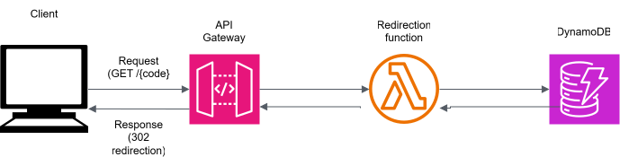

# ZeptoURL

**A serverless URL shortener on AWS, provisioned end-to-end with Terraform.**


ZeptoURL turns long URLs into short codes and redirects anyone who opens one. It's a portfolio project focused on **cloud architecture**: Lambda, API Gateway, DynamoDB, Cognito, S3 and CloudFront, all defined as code and deployed to separate `dev` and `prod` environments. The React frontend is deliberately minimal. Its job is to show the infrastructure working.

## Live demo

- **App:** [https://dibsi8elps6e.cloudfront.net/](https://dibsi8elps6e.cloudfront.net/). Sign up with an email address; Cognito sends a verification code.
- **Try a short link:** [https://vk2sq2cuz6.execute-api.us-east-1.amazonaws.com/lLyoqca](https://vk2sq2cuz6.execute-api.us-east-1.amazonaws.com/lLyoqca). It redirects right back to this repo.

## Architecture



_The redirect path. More diagrams are on the way._

The system has two flows:

- **Managing links (authenticated).** The React SPA is served from a private S3 bucket through CloudFront. Users sign in with Cognito, and the SPA calls API Gateway with the Cognito access token. API Gateway's JWT authorizer validates the token **before** any Lambda runs, then routes to the `create`, `list` or `delete` function, each of which talks to DynamoDB.
- **Following a short link (public).** `GET /{code}` hits the `redirect` Lambda, which does a single `GetItem` on DynamoDB and returns a `302` to the original URL.

## AWS services

| Service                    | What it does here                                                     | Why this choice                                                  |
| -------------------------- | --------------------------------------------------------------------- | ---------------------------------------------------------------- |
| **Lambda** (Node.js 22)    | Four single-purpose functions: `create`, `list`, `delete`, `redirect` | Pay per invocation, nothing to patch, scales to zero             |
| **API Gateway** (HTTP API) | Routes requests, validates JWTs, handles CORS                         | Cheaper than a REST API, with a built-in JWT authorizer          |
| **DynamoDB**               | Stores links (`code` → `url`, `ownerId`, `createdAt`)                 | On-demand billing, single-digit-ms key lookups for redirects     |
| **Cognito**                | User sign-up, email verification, sign-in                             | Managed auth that issues JWTs API Gateway can verify natively    |
| **S3**                     | Hosts the built frontend                                              | Static hosting; the bucket is fully private                      |
| **CloudFront** + OAC       | HTTPS, caching and edge delivery for the SPA                          | Only CloudFront can read the bucket, using SigV4-signed requests |
| **IAM**                    | One role per Lambda                                                   | Least privilege, generated by Terraform                          |
| **CloudWatch Logs**        | Lambda logs                                                           | Comes with `AWSLambdaBasicExecutionRole`                         |

## Design decisions

### HTTP API instead of REST API

API Gateway's HTTP APIs cost about **$1.00 per million requests vs $3.50** for REST APIs in `us-east-1`, roughly 70% cheaper. For a URL shortener, where every redirect is an API call, that's the line item that grows. HTTP APIs also ship a native **JWT authorizer**, so Cognito tokens are verified without a custom authorizer Lambda. None of the REST-only features (usage plans, request validation, WAF on the stage) are needed here.

### Least-privilege IAM, generated from one map

Every Lambda gets **its own IAM role**, allowed to perform exactly one DynamoDB action. Everything about an endpoint lives in a single map in [`infra/modules/api/locals.tf`](infra/modules/api/locals.tf):

```hcl
lambdas = {
  redirect = { route = "GET /{code}",          public = true,  actions = ["dynamodb:GetItem"],    resource_arn = var.table_arn }
  create   = { route = "POST /links",          public = false, actions = ["dynamodb:PutItem"],    resource_arn = var.table_arn }
  list     = { route = "GET /links",           public = false, actions = ["dynamodb:Query"],      resource_arn = "${var.table_arn}/index/*" }
  delete   = { route = "DELETE /links/{code}", public = false, actions = ["dynamodb:DeleteItem"], resource_arn = var.table_arn }
}
```

Terraform uses `for_each` over this map to create the zip package, the function, the IAM role and policy, the API integration, the route (public or JWT-protected) and the invoke permission. **Adding an endpoint means adding one line.** The public `redirect` function can only read, and `list` can only query the index.

### Environments from shared modules

`infra/envs/dev` and `infra/envs/prod` compose the same four modules (`data`, `api`, `auth`, `site`), so the environments differ only in inputs, never in code. Every resource name is suffixed with the environment (for example `ZeptoURL-dev-create`, `ZeptoURL_urls-prod`). Every resource also carries default tags (`Project`, `Environment`, `ManagedBy = terraform`) for cost tracking. It's the same promotion model a real team would use, at a small scale.

### DynamoDB access patterns

The table is designed around its two queries:

- **Redirect:** partition key `code` gives a single `GetItem` per redirect.
- **"My links, newest first":** a global secondary index on `ownerId` + `createdAt`, queried with `ScanIndexForward: false`.

Billing is **on-demand**: no capacity planning, and zero cost when idle.

### Private origin for the frontend

The S3 bucket blocks all public access. CloudFront reads it through **Origin Access Control**, and the bucket policy only trusts this specific distribution. CloudFront forces HTTPS and maps S3's `403`/`404` to `index.html`, so client-side routes like `/dashboard` survive a page refresh.

### Correctness in the handlers

- **Collision-safe codes.** `create` generates a 7-character base-62 code with `crypto.randomInt` and writes it with `attribute_not_exists(code)`, retrying on the rare collision. Two users can never overwrite each other's link.
- **Ownership enforced in the database.** `delete` uses `ConditionExpression: ownerId = :o`, so a user can't delete someone else's link even with a valid code.
- **Identity from the token, never the body.** The owner ID is the `sub` claim that API Gateway has already verified.
- **Input validation.** Only `http`/`https` URLs up to 2048 characters are accepted.
- **Cached redirects.** Redirects return `Cache-Control: public, max-age=60`; misses return `no-store`.

## API

| Method   | Route           | Auth   | Lambda     | Returns                                |
| -------- | --------------- | ------ | ---------- | -------------------------------------- |
| `GET`    | `/{code}`       | Public | `redirect` | `302` to the original URL, or `404`    |
| `POST`   | `/links`        | JWT    | `create`   | `201` `{ code, url, createdAt }`       |
| `GET`    | `/links`        | JWT    | `list`     | `200` `{ items: [...] }`, newest first |
| `DELETE` | `/links/{code}` | JWT    | `delete`   | `204`, or `404` if not yours           |

## Repository layout

```
.
├── backend/
│   └── lambdas/              # one folder per function, each with index.mjs
│       ├── create/
│       ├── delete/
│       ├── list/
│       └── redirect/
├── frontend/                 # React + Vite client (see frontend/README.md)
├── infra/
│   ├── envs/
│   │   ├── dev/              # root module per environment
│   │   └── prod/
│   └── modules/
│       ├── api/              # Lambda, IAM, API Gateway, JWT authorizer
│       ├── auth/             # Cognito user pool and client
│       ├── data/             # DynamoDB table and GSI
│       └── site/             # S3 bucket, CloudFront, OAC
└── docs/diagrams/
```

Terraform packages each `backend/lambdas/<name>` folder straight from this repo through a relative path. That's why backend and infra live together in one monorepo.

## Deploy it yourself

**Prerequisites:** an AWS account, [AWS CLI](https://aws.amazon.com/cli/) configured, [Terraform](https://developer.hashicorp.com/terraform/install) and Node.js 22.

### 1. Infrastructure and backend

```bash
cd infra/envs/dev            # or infra/envs/prod
terraform init
terraform apply -var="env=dev"
```

Terraform zips and uploads the Lambda code itself, so there's no separate backend deploy. When it finishes, run `terraform output` to get the values for the next step.

### 2. Frontend

Create `frontend/.env.production` (or `.env.development` for the dev stack) from the Terraform outputs:

| Variable                   | Terraform output                                                  |
| -------------------------- | ----------------------------------------------------------------- |
| `VITE_API_URL`             | `api_endpoint`                                                    |
| `VITE_USER_POOL_ID`        | The last segment of `issuer_url` (for example `us-east-1_AbC123`) |
| `VITE_USER_POOL_CLIENT_ID` | `client_id`                                                       |

Build it and upload it to the site bucket:

```bash
cd frontend
npm ci
npm run build                                   # → dist/production/

# Hashed assets: cache for a year
aws s3 sync dist/production/ s3://<bucket_name> --delete --exclude index.html \
  --cache-control "public,max-age=31536000,immutable"

# index.html: never cache, so new deploys show up immediately
aws s3 cp dist/production/index.html s3://<bucket_name>/index.html --cache-control "no-cache"

aws cloudfront create-invalidation --distribution-id <distribution_id> --paths "/index.html"
```

The app is then live at `https://dibsi8elps6e.cloudfront.net`.

Thanks for reading. This project is [never](https://vk2sq2cuz6.execute-api.us-east-1.amazonaws.com/KfNz8Ec) going to let you down.
